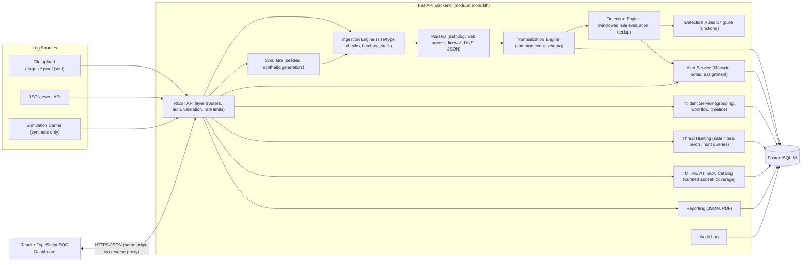
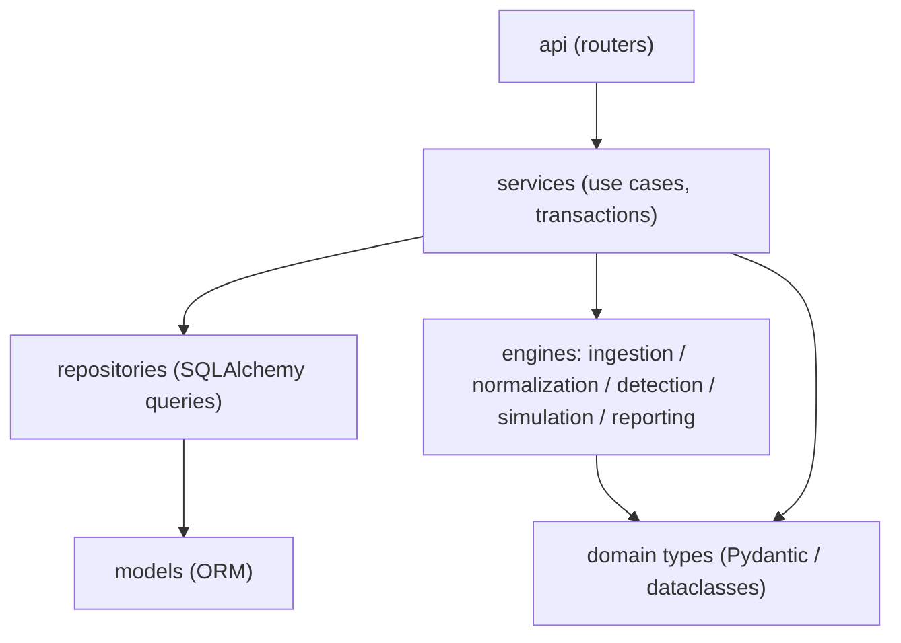
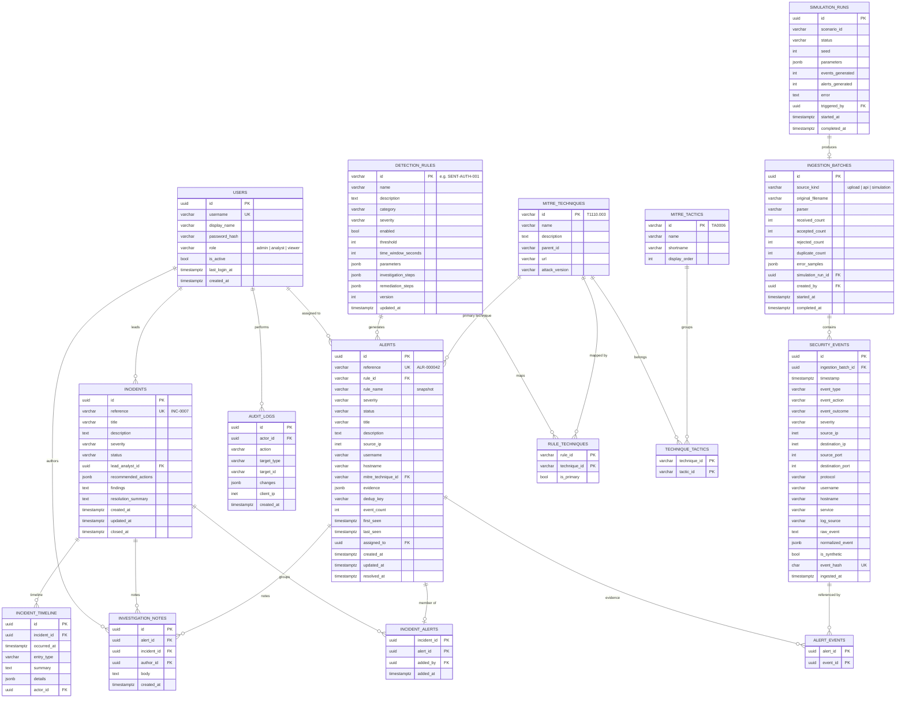
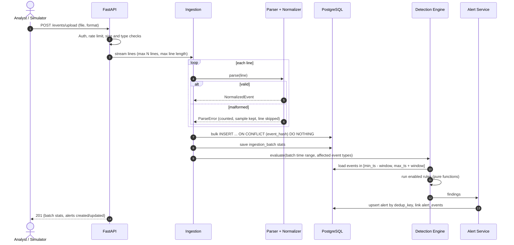
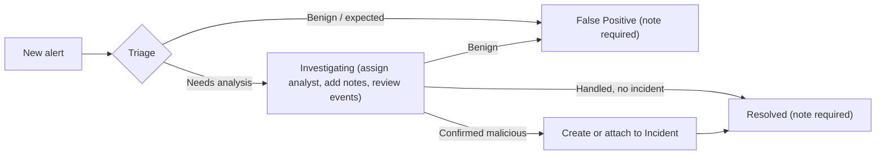
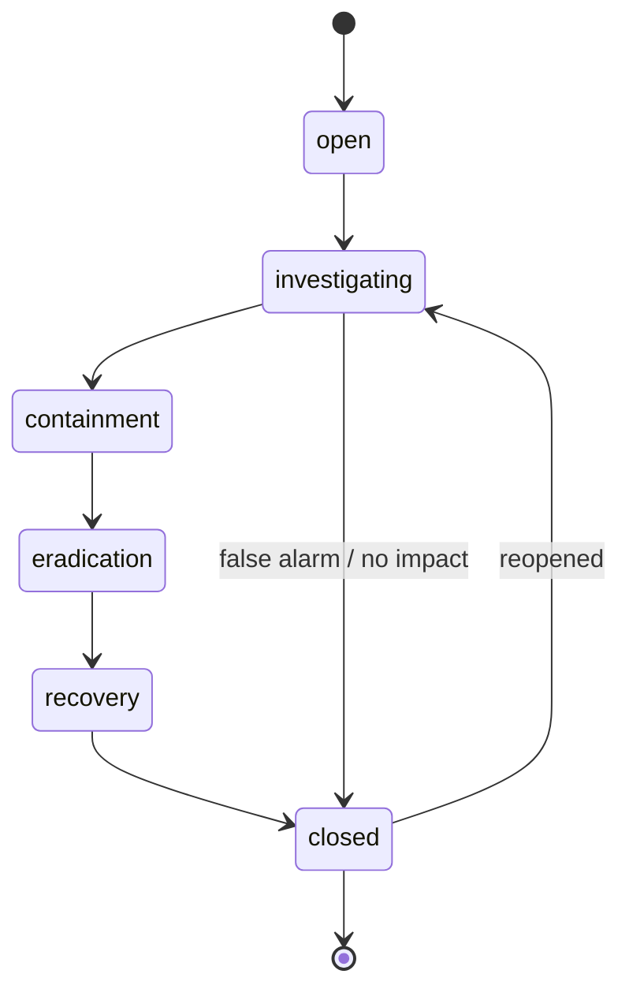
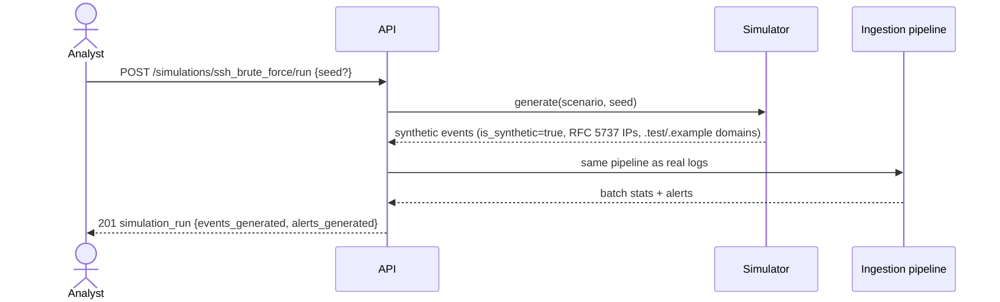
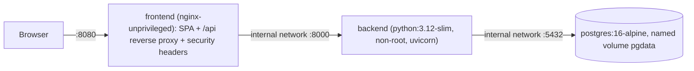

# SENTINEL SOC — Development Plan

> Security monitoring, threat detection and incident response platform.
> Local, self-hosted, Docker-based. Portfolio project. **All demonstration data is synthetic.**

| Field | Value |
|---|---|
| Document version | 1.0 (Phase 1 deliverable) |
| Created | 2026-11-16 |
| Current phase | **Phase 1 — Architecture & Planning (awaiting approval)** |
| Project root | `C:\Users\Cristi\.gemini\antigravity\scratch\sentinel-soc` |

---

## Progress Tracker

| Phase | Name | Status |
|---|---|---|
| 1 | Architecture & Planning | 🟢 Done (Approved) |
| 2 | Backend Foundation (config, DB, models, migrations, auth, health) | 🟢 Done |
| 3 | Log Ingestion & Normalization | 🟢 Done |
| 4 | Detection Engine (7 rules) | 🟢 Done |
| 5 | Alert & Incident Management | 🟢 Done |
| 6 | MITRE ATT&CK & Threat Hunting | 🟢 Done |
| 7 | Frontend (all pages wired to API) | 🟢 Done |
| 8 | Simulation Center & Reporting | 🟢 Done |
| 9 | Docker & Security Hardening | 🟢 Done |
| 10 | Final QA & Documentation | 🟢 Done |

Legend: ⚪ not started · 🔵 in progress · 🟡 awaiting review · 🟢 done · 🔴 blocked

---

## 1. Workspace Inspection (2026-11-16)

| Item | Finding | Impact |
|---|---|---|
| Workspace | Empty; new project in `scratch\sentinel-soc` | Greenfield. No legacy constraints. |
| Python | 3.13.14 (no 3.12 installed) | OK. The code targets `>=3.12`. The Docker image pins 3.12. CI tests both versions. |
| Node.js / npm | v25.8.0 / 11.11.0 | Node 25 is not an LTS release. Docker and CI pin **Node 22 LTS**. Local development on 25 should still work. |
| Git | 2.53.0 | OK |
| Docker / Compose | **Not installed** | 🔴 Blocks Phase 9 and local PostgreSQL. See Risk R1. |
| PostgreSQL (`psql`) | **Not installed** | 🔴 DB integration tests need a real PostgreSQL. See Risk R1. |

---

## 2. Goals, Scope and Non-Goals

### In scope
Ingest logs → normalize → detect → alert → triage → group into incidents → report. MITRE ATT&CK
mapping, threat hunting, a synthetic attack simulator, and a dark-themed SOC dashboard.

### Non-goals (deliberately excluded to keep complexity honest)
- No real attacks, packet generation, network scanning or external network calls from the simulator.
- No execution of uploaded content. Files are parsed as text only.
- No streaming pipeline (Kafka), search cluster (Elasticsearch) or microservices.
- No ML-based detection. All detections are transparent, explainable heuristics.
- No live agents or collectors on endpoints. Logs arrive by upload, API or simulation.
- No claims of detection accuracy. Rules are heuristics with documented false-positive and false-negative trade-offs.

---

## 3. Architecture Overview

### 3.1 Style: modular monolith

One FastAPI process holds clearly separated internal modules. They have explicit boundaries and
one-way dependencies.

**Why not microservices?** A SOC platform in production (for example Splunk or Elastic) is distributed
because of data volume. This project runs on one machine. Microservices would add network failure modes,
service discovery and distributed transactions without teaching anything about detection engineering.
A modular monolith keeps the *logical* separation, which is what interviewers look for. Ingestion,
detection and alerting could be split out later if needed.

**Key design principle: a pure detection core.**
The parsers, the normalizer and the detection rules are **plain Python with no FastAPI or database
imports**. A rule takes a list of normalized events and returns findings. As a result:
- Every rule is unit-testable in milliseconds with hand-built events.
- Detection logic can be explained and reviewed on its own, as a detection engineer would.
- The database layer only loads events and persists findings.

### 3.2 System component diagram



### 3.3 Module dependency rules



- `engines` **never** import `api`, `services` or `repositories`. They are pure and testable.
- `api` never talks to the ORM directly. It always goes through `services`.

---

## 4. Technology Choices

| Area | Choice | Rationale / trade-off |
|---|---|---|
| Language | Python 3.12+ | Requested. Mature security ecosystem. Strong typing via type hints and mypy. |
| API | FastAPI | Typed request validation with Pydantic v2. Automatic OpenAPI docs. Dependency injection for auth and DB sessions. |
| Validation | Pydantic v2 (`extra="forbid"`, constrained types) | Rejects unexpected fields and out-of-range values at the boundary (OWASP input validation). |
| Settings | pydantic-settings | Typed environment-variable config. The app fails fast on missing secrets. |
| ORM | SQLAlchemy 2.0, **synchronous**, psycopg 3 driver | Sync code is simpler to read, debug and test. FastAPI runs sync endpoints in a thread pool, which is plenty for a single-node SOC. Async would add complexity with no measurable benefit here. |
| Migrations | Alembic | Versioned, reviewable schema changes. CI checks that migrations upgrade and downgrade cleanly. |
| Database | PostgreSQL 16 | `INET` type (native IP validation and CIDR queries such as `source_ip <<= '10.0.0.0/8'`), `JSONB` + GIN indexes, partial unique indexes (used for alert deduplication), `timestamptz`. |
| Auth | Argon2id password hashing (argon2-cffi), signed JWT in an **HttpOnly, SameSite=Strict cookie**, plus a CSRF header check | Argon2id is the OWASP-recommended password hash. An HttpOnly cookie keeps the token away from JavaScript, so an XSS cannot steal it. SameSite=Strict plus a required custom header mitigates CSRF. |
| Rate limiting | Small in-house fixed-window limiter (FastAPI dependency) | About 50 lines, fully testable, no stale third-party dependency. Documented limitation: in-memory, single process. |
| Logging | structlog (JSON output) | Structured logs with request IDs. A redaction processor masks keys such as `password`, `token`, `authorization` and `cookie`. |
| PDF | ReportLab | Pure Python with no headless browser or system libraries, which means a smaller container attack surface. |
| Domain parsing | tldextract **in offline mode** (bundled Public Suffix List snapshot) | Correct registered-domain extraction (`a.b.example.co.uk` → `example.co.uk`). Offline mode guarantees no runtime network calls. |
| Testing | pytest, pytest-cov, FastAPI TestClient (httpx) | Standard Python tooling. |
| Lint/format/types | ruff (lint + format), mypy | ruff replaces flake8, isort and black in a single fast tool. |
| Frontend | React + TypeScript + Vite | Requested. |
| Styling | Tailwind CSS + a small set of custom components | Consistent design tokens without a heavy UI framework. |
| Data fetching | TanStack Query | Handles caching, loading/error states and refetching. Avoids hand-written fetch state everywhere. |
| Routing | React Router | Standard. |
| Charts | Recharts | Requested. Declarative and works well with TypeScript. |
| Icons/fonts | lucide-react; Inter + JetBrains Mono via `@fontsource` (self-hosted) | No external CDN requests, so the CSP can be strict and nothing leaks to third parties. |
| Frontend tests | Vitest + React Testing Library + MSW (mock API) | Component and workflow tests without a running backend. |
| Frontend lint | ESLint + Prettier | Standard. |
| Containers | Docker + Docker Compose; nginx (unprivileged image) serves the SPA and reverse-proxies `/api` | Same origin, so no CORS is needed in the containerized setup. nginx also adds security headers and a request body size limit. |
| CI | GitHub Actions with a PostgreSQL service container | Runs lint, types, tests and migration checks on every push. Also mitigates the missing local Docker install. |

**Dependency pinning policy:** exact versions (`==`) are chosen and verified at install time in Phase 2
(backend `pyproject.toml`) and Phase 7 (`package-lock.json`). Versions are not guessed in this document.

---

## 5. Proposed Folder Structure

```text
sentinel-soc/
├── backend/
│   ├── app/
│   │   ├── main.py                    # App factory, middleware, router registration
│   │   ├── cli.py                     # create-admin, seed, etc.
│   │   ├── core/
│   │   │   ├── config.py              # pydantic-settings
│   │   │   ├── logging.py             # structlog + redaction
│   │   │   ├── security.py            # Argon2id, JWT, CSRF
│   │   │   ├── errors.py              # Exception types + consistent error envelope
│   │   │   ├── rate_limit.py          # In-memory limiter dependency
│   │   │   └── middleware.py          # Request ID, security headers
│   │   ├── db/
│   │   │   ├── base.py                # Declarative base, naming conventions
│   │   │   └── session.py             # Engine, SessionLocal, get_db
│   │   ├── models/                    # SQLAlchemy ORM models (one file per aggregate)
│   │   ├── schemas/                   # Pydantic request/response models
│   │   ├── repositories/              # Query logic (parameterized, no string SQL)
│   │   ├── services/                  # Use cases: alerts, incidents, hunting, dashboard, ...
│   │   ├── api/
│   │   │   ├── deps.py                # get_db, current_user, require_role
│   │   │   └── v1/                    # health, auth, events, alerts, incidents, ...
│   │   ├── domain/                    # Shared pure types: NormalizedEvent, Severity, Finding
│   │   ├── ingestion/
│   │   │   ├── pipeline.py            # Batch processing, stats, dedup hashing
│   │   │   ├── upload.py              # Size/type/encoding validation
│   │   │   └── parsers/               # auth_log.py, web_access.py, firewall.py, dns_query.py, json_events.py
│   │   ├── normalization/             # normalizer.py, field validators
│   │   ├── detection/
│   │   │   ├── engine.py              # Loads windows, runs rules, deduplicates findings
│   │   │   ├── base.py                # DetectionRule protocol + RuleMetadata
│   │   │   ├── windowing.py           # Sliding-window helpers
│   │   │   ├── utils.py               # Shannon entropy, URL decoding, etc.
│   │   │   └── rules/                 # One module per rule
│   │   ├── mitre/
│   │   │   ├── catalog.py
│   │   │   └── data/attack_subset.json  # Curated techniques + ATT&CK version + attribution
│   │   ├── hunting/                   # Predefined hunt queries
│   │   ├── simulation/
│   │   │   ├── generator.py           # Seeded random, synthetic identity pools
│   │   │   └── scenarios/             # One module per scenario
│   │   └── reporting/                 # json_report.py, pdf_report.py
│   ├── alembic/                       # env.py + versions/
│   ├── seeds/                         # Rule defaults, demo users (password from env)
│   ├── sample_logs/                   # Synthetic sample files for upload demos
│   ├── tests/
│   │   ├── unit/                      # parsers, normalizer, each rule, utils, security
│   │   ├── integration/               # repositories + services against PostgreSQL
│   │   ├── api/                       # endpoint tests via TestClient
│   │   ├── factories.py               # Event builders for tests
│   │   └── conftest.py
│   ├── alembic.ini
│   ├── pyproject.toml                 # deps (pinned), ruff, mypy, pytest config
│   └── Dockerfile
├── frontend/
│   ├── src/
│   │   ├── api/                       # Typed API client + TanStack Query hooks
│   │   ├── components/                # ui/ (Button, Badge, Table, Card...), charts/, layout/
│   │   ├── pages/                     # Overview, Alerts, AlertDetail, Incidents, ...
│   │   ├── types/                     # Shared TS types (mirrors API schemas)
│   │   ├── lib/                       # formatting, severity colors, etc.
│   │   └── test/                      # MSW handlers, test utils
│   ├── nginx.conf
│   ├── package.json
│   └── Dockerfile
├── docs/
│   ├── architecture.md
│   ├── detection-rules.md
│   ├── api.md
│   ├── threat-model.md
│   ├── incident-response-workflow.md
│   └── screenshots/
├── .github/workflows/ci.yml
├── docker-compose.yml
├── .env.example
├── .gitignore
├── README.md
├── DEVELOPMENT_PLAN.md
├── CONTRIBUTING.md
├── SECURITY.md
└── LICENSE (MIT)
```

---

## 6. Normalized Event Schema

The schema follows the spirit of the **Elastic Common Schema (ECS)**: a coarse *category*
(`event_type`), a specific *action* and an *outcome*. "Failed SSH login" is therefore not its own
type. It is `event_type=authentication, event_action=ssh_login, event_outcome=failure`. Detection
rules can then be written generically, for example "any authentication failure".

| Field | Type | Notes |
|---|---|---|
| `event_id` | UUID | Generated on ingest |
| `timestamp` | timestamptz (UTC) | **Event time** from the log, not ingest time. Detection windows use this field. |
| `ingested_at` | timestamptz | Server time |
| `event_type` | enum | `authentication`, `network_connection`, `firewall`, `dns_query`, `http_request`, `process_execution` |
| `event_action` | string | e.g. `ssh_login`, `sudo`, `su`, `user_add`, `connection_attempt`, `query`, `request`, `exec` |
| `event_outcome` | enum | `success`, `failure`, `unknown` |
| `severity` | enum | `informational`, `low`, `medium`, `high`, `critical` (assigned by the parser) |
| `source_ip` / `destination_ip` | INET | Validated by `ipaddress`; IPv4 and IPv6 |
| `source_port` / `destination_port` | int | CHECK 0–65535 |
| `protocol` | string | `tcp`, `udp`, `icmp`, `http`, `dns`, `ssh`... |
| `username` | string | Max 256 characters |
| `hostname` | string | Host that emitted the log |
| `service` | string | `sshd`, `sudo`, `nginx`, `named`, `kernel`, ... |
| `log_source` | string | Parser that produced the event (`linux_auth`, `web_access`, `iptables`, `bind_query`, `json`) |
| `raw_event` | text | Original line, truncated to the maximum line length |
| `normalized_event` | JSONB | Full normalized document, including type-specific fields (`http.method`, `url.path`, `user_agent.original`, `http.response.status_code`, `dns.question.name`, `dns.question.type`, `process.command_line`, `process.parent.name`, ...) |
| `is_synthetic` | bool | `true` for every simulator-generated event |
| `event_hash` | char(64) | SHA-256 of `log_source + raw_event`, used for idempotent re-ingestion |

### Supported input formats (Phase 3)

| Parser | Example source | Produces |
|---|---|---|
| `linux_auth` | `/var/log/auth.log` (sshd, sudo, su, useradd) | authentication, process_execution |
| `web_access` | nginx/Apache *combined* log format | http_request |
| `iptables` | Kernel/UFW firewall log (`SRC= DST= PROTO= SPT= DPT=`) | firewall |
| `bind_query` | BIND9 query log | dns_query |
| `json` | JSON Lines / JSON array matching the documented ingest schema | any type (including network_connection, process_execution) |

---

## 7. Database Schema

### 7.1 Entity-relationship diagram



### 7.2 Constraints and indexes (highlights)

| Table | Constraint / index | Purpose |
|---|---|---|
| `security_events` | `UNIQUE(event_hash)` | Re-uploading the same file creates no duplicate events (idempotent ingestion) |
| `security_events` | B-tree on `timestamp`, `(event_type, timestamp)`, `source_ip`, `destination_ip`, `username` | Detection windows, explorer filters, hunting pivots |
| `security_events` | GIN (`jsonb_path_ops`) on `normalized_event` | Field-level hunting queries |
| `security_events` | CHECK ports 0–65535; CHECK enum values | Database-level integrity as a second line of defence |
| `alerts` | **Partial unique index** on `dedup_key WHERE status IN ('new','investigating')` | At most one *open* alert per rule + entity. Repeated activity updates that alert instead of flooding the queue. |
| `alerts` | Indexes on `(status, severity)`, `created_at`, `source_ip`, `rule_id` | Alert queue filtering |
| `incident_alerts` | `UNIQUE(alert_id)` | An alert belongs to at most one incident (keeps ownership unambiguous) |
| `investigation_notes` | CHECK exactly one of `alert_id` / `incident_id` is set; `length(body) <= 10000` | Integrity, abuse limits |
| `detection_rules` | CHECK `threshold BETWEEN 1 AND 100000`, `time_window_seconds BETWEEN 10 AND 86400` | Prevents misconfiguration |
| All | `created_at` / `updated_at` with server defaults; FK `ON DELETE` rules explicit | Auditability |

Enums are stored as `varchar` with CHECK constraints rather than native PostgreSQL enums, because native
enums are awkward to change in Alembic migrations.

### 7.3 Seed data
- `detection_rules` + `rule_techniques`: the 7 rules with their default configuration (Section 10).
- `mitre_tactics` / `mitre_techniques`: a curated subset of ATT&CK techniques (implemented and documented-only) with attribution.
- Demo users: created by `python -m app.cli create-user`, with the password supplied via environment variable or prompt. **No default passwords.**
- Demo events: produced by running the simulator (`python -m app.cli seed-demo`), so the data is fresh and labelled synthetic.

---

## 8. Main Application Workflows

### 8.1 Ingestion → Normalization → Detection → Alert



**Why re-evaluate a window around the batch?** Logs often arrive late or out of order. Taking the
batch's event-time range and padding it by the rule window means an attack split across two uploads is
still detected. Alert upsert by `dedup_key` makes re-evaluation **idempotent**: running detection twice
on the same events never duplicates alerts.

### 8.2 Analyst triage workflow



Allowed alert status transitions are enforced server-side. Moving to `resolved` or `false_positive`
requires a note: in a real SOC, closing an alert without a rationale fails audit and loses tuning
feedback.

### 8.3 Incident response lifecycle (inspired by NIST SP 800-61)



Every status change, alert attachment and note automatically appends an `incident_timeline` entry
and an `audit_logs` record.

### 8.4 Simulation run



The simulator uses the **same ingestion path** as real logs, so a simulation exercises the whole pipeline
end to end. It writes rows to the database only. It never sends packets.

---

## 9. API Design

Base path: **`/api/v1`**. Versioning lets the API change later without breaking existing clients.
OpenAPI is served at `/api/docs`. Docs can be disabled with `ENABLE_API_DOCS=false`.

### 9.1 Conventions
- **Pagination:** `?limit=50&offset=0` (maximum `limit` 200). Response: `{ "items": [...], "total": n, "limit": l, "offset": o }`.
- **Sorting:** `?sort=-timestamp`, restricted to an allowlist of sortable fields.
- **Error envelope** (no stack traces or SQL errors ever reach the client):
  ```json
  { "error": { "code": "validation_error", "message": "Invalid request", "details": [...], "request_id": "..." } }
  ```
- **Status codes:** 200, 201, 204, 400, 401, 403, 404, 409 (invalid state transition / conflict), 413 (file too large), 415 (unsupported type), 422 (validation), 429 (rate limited), 500 (generic).
- **Roles:** `viewer` (read-only), `analyst` (triage, notes, incidents, simulations, uploads), `admin` (everything, including rule configuration and users).

### 9.2 Endpoints

| Method | Path | Role | Description |
|---|---|---|---|
| GET | `/health` | public | Liveness |
| GET | `/health/ready` | public | Readiness (DB reachable) |
| POST | `/auth/login` | public, rate-limited | Sets HttpOnly session cookie |
| POST | `/auth/logout` | any | Clears cookie |
| GET | `/auth/me` | any | Current user |
| GET | `/users` | analyst | Analyst list (for assignment) |
| GET | `/system/info` | viewer | Version, rule count, event counts, config summary (no secrets) |
| GET | `/dashboard/overview?range=24h` | viewer | KPIs, events per hour, severity distribution, top IPs, detection timeline |
| GET | `/events` | viewer | Filter: `ip`, `cidr`, `username`, `hostname`, `event_type`, `outcome`, `severity`, `from`, `to`, `q` |
| GET | `/events/{event_id}` | viewer | Raw + normalized view |
| POST | `/events/ingest` | analyst, rate-limited | JSON batch (max 1,000 events) |
| POST | `/events/upload` | analyst, rate-limited | Multipart file + `format` (or `auto`) |
| GET | `/ingestion/batches` | viewer | Ingestion history and statistics |
| GET | `/ingestion/batches/{id}` | viewer | Batch detail including error samples |
| GET | `/detections/rules` | viewer | All rules + config + MITRE mapping |
| GET | `/detections/rules/{rule_id}` | viewer | Rule detail |
| PATCH | `/detections/rules/{rule_id}` | admin | Enable/disable, threshold, window, parameters (validated bounds, audited) |
| POST | `/detections/run` | analyst | Re-run detection over a time range |
| GET | `/alerts` | viewer | Filter: `status`, `severity`, `rule_id`, `ip`, `username`, `assigned_to`, `from`, `to`, `q` |
| GET | `/alerts/{alert_id}` | viewer | Detail + evidence + MITRE + notes |
| PATCH | `/alerts/{alert_id}` | analyst | Status (state machine), assignee |
| GET | `/alerts/{alert_id}/events` | viewer | Related events |
| POST | `/alerts/{alert_id}/notes` | analyst | Add investigation note |
| GET | `/incidents` | viewer | Filter: `status`, `severity`, `lead`, `q` |
| POST | `/incidents` | analyst | Create (optionally with `alert_ids`) |
| GET | `/incidents/{incident_id}` | viewer | Detail + alerts + timeline + notes |
| PATCH | `/incidents/{incident_id}` | analyst | Status (state machine), severity, lead, findings, actions |
| POST | `/incidents/{incident_id}/alerts` | analyst | Attach alerts |
| DELETE | `/incidents/{incident_id}/alerts/{alert_id}` | analyst | Detach alert |
| POST | `/incidents/{incident_id}/notes` | analyst | Add note (also creates a timeline entry) |
| GET | `/mitre/techniques` | viewer | `?coverage=implemented\|documented`, `?tactic=` |
| GET | `/mitre/coverage` | viewer | Coverage grouped by tactic |
| GET | `/hunting/search` | viewer | Structured hunt filters (same safe filter model as `/events`, plus JSON field filters from an allowlist) |
| GET | `/hunting/entities/ip/{ip}` | viewer | IP pivot: first/last seen, event types, targeted users/ports, related alerts |
| GET | `/hunting/entities/user/{username}` | viewer | User pivot: source IPs, auth success/failure, privileged actions, alerts |
| GET | `/hunting/queries` | viewer | Predefined hypothesis-driven hunts |
| POST | `/hunting/queries/{query_id}/run` | viewer | Run a predefined hunt (parameterized, read-only) |
| GET | `/simulations/scenarios` | viewer | Available scenarios |
| GET | `/simulations/runs` | viewer | Simulation history |
| POST | `/simulations/{scenario_id}/run` | analyst, rate-limited | Run a scenario (optional `seed`) |
| GET | `/reports/incidents/{incident_id}` | viewer | JSON report |
| GET | `/reports/incidents/{incident_id}/pdf` | viewer | PDF report |

---

## 10. Detection Rule Specifications

### 10.1 Common rule contract

```python
class DetectionRule(Protocol):
    metadata: RuleMetadata          # id, name, description, severity, mitre, investigation, remediation
    event_types: frozenset[EventType]

    def evaluate(self, events: Sequence[NormalizedEvent], config: RuleConfig) -> list[Finding]: ...
```

A `Finding` contains: `rule_id`, `severity`, `group_key` (for example `ip=203.0.113.7`), `title`,
`description`, `evidence` (structured summary), `event_ids`, `first_seen`, `last_seen`,
`mitre_technique_id`.

### 10.2 Window semantics (precisely defined, so the boundaries can be tested)
- Window evaluation is **sliding**, using a two-pointer scan over events sorted by event timestamp per group.
- An event set qualifies when `last.timestamp - first.timestamp <= time_window_seconds` (**inclusive**).
  For example, with a 300 s window: 10 failures spanning exactly 300 s → **alert**; spanning 301 s → **no alert**.
- Events whose `event_hash` was already stored are never inserted twice, so duplicate log lines cannot inflate counts.
- **Dedup key:** `sha256(rule_id + group_key)`. If an open alert with that key exists, it is updated (`event_count`, `last_seen`, `alert_events`) instead of creating a new one. Once it is resolved, new activity creates a **new** alert.
- **Allowlists:** every rule supports `parameters.allowlist_ips` (CIDRs), for example for authorized vulnerability scanners and monitoring hosts. Allowlisting is the main false-positive control in a real SOC.

### 10.3 Rule summary

| Rule ID | Name | Default severity | Threshold | Window | Primary MITRE technique |
|---|---|---|---|---|---|
| SENT-AUTH-001 | SSH Brute Force | High | ≥ 10 failed SSH logins from one source IP | 300 s | T1110.001 Brute Force: Password Guessing |
| SENT-AUTH-002 | Password Spraying | High | ≥ 5 distinct usernames failed from one source IP, ≤ 3 attempts per user on average | 1800 s | T1110.003 Brute Force: Password Spraying |
| SENT-AUTH-003 | Multiple Failed Logins (Single Account) | Medium | ≥ 5 failures against one username (any source) | 900 s | T1110.001 Brute Force: Password Guessing |
| SENT-NET-001 | Port Scanning | Medium | ≥ 20 distinct destination ports from one source to one destination | 60 s | T1046 Network Service Discovery |
| SENT-DNS-001 | Suspicious DNS Activity | Medium | Per-query indicators, or ≥ 50 unique subdomains of one registered domain from one source | 600 s | T1071.004 Application Layer Protocol: DNS |
| SENT-WEB-001 | Suspicious HTTP Activity | Medium | Any attack-pattern request, or ≥ 30 HTTP 404s from one source | 300 s | T1190 Exploit Public-Facing Application |
| SENT-PRIV-001 | Unusual Privileged Activity | High | Any match of the configured privileged-activity conditions | 3600 s | T1548.003 Abuse Elevation Control Mechanism: Sudo and Sudo Caching |

All thresholds and windows are **defaults**, editable on the Settings page within validated bounds.
They are starting points for tuning, not universal truths.

### 10.4 Detailed specifications

#### SENT-AUTH-001 — SSH Brute Force
- **Description:** Many failed SSH authentication attempts from a single source IP in a short period. This is typical of automated password-guessing tools.
- **Input:** `event_type=authentication`, `service=sshd`, `event_outcome=failure` (includes "invalid user" attempts).
- **Logic:** group by `source_ip` → sliding window → count ≥ `threshold`.
- **Escalation:** severity is raised to **Critical** if an `ssh_login` **success** from the same IP occurs within the window after the failures. That pattern suggests a possibly successful brute force.
- **Evidence:** attempt count, distinct usernames tried (top 10), target hosts, first/last seen, success-after-failure flag.
- **False-positive considerations:** misconfigured automation with a stale key or password; users who forgot a password (usually far below 10 attempts in 5 minutes). Mitigated by allowlists and a sensible threshold.
- **MITRE:** T1110.001 (primary); T1021.004 Remote Services: SSH (documented context).
- **Investigation:** check whether any login from the IP succeeded; review IP reputation (outside the platform); check which accounts were targeted and whether they exist; check other activity from the IP (scans, web probes).
- **Remediation:** block the source at the firewall; enforce key-only SSH auth (`PasswordAuthentication no`); disable root SSH login; deploy fail2ban or equivalent; reset credentials if a success followed.

#### SENT-AUTH-002 — Password Spraying
- **Description:** One source tries a few common passwords across **many** accounts to stay under per-account lockout thresholds.
- **Input:** authentication failures (any service).
- **Logic:** group by `source_ip` → window → distinct `username` ≥ threshold **and** average attempts per username ≤ `parameters.max_avg_attempts_per_user` (default 3). The second condition separates spraying (wide and shallow) from brute force (narrow and deep).
- **Evidence:** distinct usernames (sample), attempts per user, services, time span.
- **False positives:** shared NAT or VPN egress IPs with many legitimate users mistyping passwords. Mitigated by allowlisting known egress IPs.
- **MITRE:** T1110.003.
- **Investigation:** look for any successful login among the targeted accounts; check whether the usernames are valid (valid-user enumeration indicates reconnaissance); correlate with other sources.
- **Remediation:** block the source; enforce MFA; enforce banned-password lists; monitor targeted accounts.

#### SENT-AUTH-003 — Multiple Failed Logins (Single Account)
- **Description:** Repeated failures against one account, possibly from several IPs (a distributed attack that per-IP rules miss).
- **Logic:** group by `username` → window → count ≥ threshold. Escalates to **High** if failures come from ≥ `parameters.distributed_ip_threshold` (default 3) distinct IPs.
- **Evidence:** count, distinct source IPs, services, success-after-failure flag.
- **False positives:** a user who forgot their password, or a service with a stale password. Very common, which is why the default severity is Medium.
- **Relationship to AUTH-001:** both rules can fire for the same activity. They look from different angles (attacker vs victim), and incident grouping consolidates them.
- **MITRE:** T1110.001.
- **Investigation:** contact the account owner; check the sources' geolocation and ownership outside the platform; check for a later success.
- **Remediation:** temporary account lockout, password reset, MFA.

#### SENT-NET-001 — Port Scanning
- **Description:** One source connecting to many ports on one destination (vertical scan) in a short time.
- **Input:** `network_connection` and `firewall` events, both allowed and blocked.
- **Logic:** group by (`source_ip`, `destination_ip`) → window → distinct `destination_port` ≥ threshold. Optional horizontal-scan variant: one port on ≥ `parameters.horizontal_host_threshold` (default 15) distinct hosts.
- **Evidence:** distinct ports (sorted sample), protocol, count of blocked vs allowed, scan rate.
- **False positives:** vulnerability scanners and monitoring systems (allowlist them), and service-discovery tools.
- **MITRE:** T1046 (primary); T1595.001 Active Scanning: Scanning IP Blocks (documented only, for external reconnaissance).
- **Investigation:** is the source internal (a possibly compromised host doing discovery) or external? Did any open (allowed) port see follow-up exploitation traffic?
- **Remediation:** block or contain the source; if internal, isolate the host and investigate it; reduce exposed services.

#### SENT-DNS-001 — Suspicious DNS Activity
- **Description:** DNS queries consistent with tunneling, data exfiltration or algorithmically generated domains (DGA).
- **Per-query indicators** (each adds to the evidence):
  - Total query length > `max_query_length` (default 75) or any label > `max_label_length` (default 50; the DNS maximum is 63).
  - Shannon entropy of the subdomain part > `entropy_threshold` (default 3.8) with length ≥ 20.
  - Registered domain under a TLD in a configurable `suspicious_tlds` list.
- **Volume indicator:** ≥ threshold unique subdomains of one registered domain from one source within the window (tunneling pattern), and high TXT-record query volume.
- **Aggregation:** one alert per (`source_ip`, registered domain) to avoid a flood of per-query alerts.
- **False positives:** CDNs, cloud load balancers and anti-virus or telemetry services legitimately use long, random-looking subdomains. A `domain_allowlist` (with suffix matching) is essential and pre-populated with documented examples.
- **MITRE:** T1071.004 (primary); T1568.002 Dynamic Resolution: Domain Generation Algorithms; T1048 Exfiltration Over Alternative Protocol (documented context).
- **Investigation:** identify the querying host and process; check query volume over time; check the domain's registration age outside the platform; look for a matching HTTP or beaconing pattern.
- **Remediation:** sinkhole or block the domain at the resolver; isolate the host; restrict outbound DNS to approved resolvers.

#### SENT-WEB-001 — Suspicious HTTP Activity
- **Description:** Web requests showing attack or reconnaissance patterns.
- **Normalization first:** the URL is percent-decoded iteratively (maximum 3 passes, to catch double encoding such as `%252e%252e%252f`) before matching.
- **Indicators:**
  - Directory traversal: `../`, `..\`, decoded variants.
  - Sensitive file probes: `/etc/passwd`, `.env`, `.git/config`, `wp-config.php`, `/.aws/credentials`.
  - SQL injection patterns: `' or 1=1`, `union select`, `sleep(`.
  - XSS patterns: `<script`, `javascript:`, `onerror=`.
  - Known scanner user agents (configurable list: sqlmap, nikto, nmap, masscan, gobuster, dirbuster, wpscan, nuclei, zgrab) or an empty user agent.
  - Behaviour: ≥ threshold HTTP 404 responses from one source in the window (forced browsing / content discovery).
- **Escalation:** **High** if a traversal or sensitive-file request returned HTTP 200 (possible successful exploitation).
- **Aggregation:** one alert per source IP per window, with all matched indicators as evidence.
- **False positives:** authorized penetration tests and scanners (allowlist), and legitimate URLs containing words like "select". Patterns are anchored on attack syntax, not single keywords.
- **ReDoS safety:** all regexes are reviewed to avoid catastrophic backtracking, and inputs are length-capped before matching.
- **MITRE:** T1190 (primary); T1595.002 Active Scanning: Vulnerability Scanning; T1595.003 Active Scanning: Wordlist Scanning.
- **Investigation:** review full request and response codes; check whether any request succeeded; check server logs and file integrity on the target.
- **Remediation:** block the source or add WAF rules; patch the application; validate paths server-side.

#### SENT-PRIV-001 — Unusual Privileged Activity
- **Description:** Privileged actions that deviate from configured expectations.
- **Input:** authentication (`sudo`, `su`, root SSH login) and `process_execution` events.
- **Conditions** (each configurable, each recorded as a sub-finding):
  1. `sudo` or `su` by a user **not** in `parameters.authorized_admins`.
  2. Failed `sudo` attempts (user not in sudoers / wrong password) ≥ `threshold` in the window.
  3. Direct `root` SSH login (successful).
  4. Execution of sensitive commands (configurable patterns): account creation (`useradd`, `usermod -aG sudo`), sudoers edits, shadow file access, history clearing (`history -c`, `unset HISTFILE`), download-and-execute (`curl ... | sh`).
  5. Privileged activity outside `parameters.business_hours` (UTC range, configurable; off by default because time-based rules are noisy).
- **Severity per condition:** for example, history clearing and download-and-execute → High; off-hours sudo by an authorized admin → Low.
- **False positives:** legitimate administration. That is why the rule relies on an explicit `authorized_admins` list and a change-management context, and is documented as needing tuning.
- **MITRE:** T1548.003 (primary); T1078.003 Valid Accounts: Local Accounts; T1136.001 Create Account: Local Account; T1070.003 Indicator Removal: Clear Command History; T1105 Ingress Tool Transfer.
- **Investigation:** confirm with the user or change management; review the full command history and session origin (source IP of the login); check for persistence (new accounts, cron jobs, SSH keys).
- **Remediation:** remove unauthorized sudo rights; disable the account if compromised; enforce `sudo` logging and least privilege; disable direct root login.

### 10.5 Required tests per rule (Phase 4)

| Test category | Example (SSH brute force) |
|---|---|
| True positive | 10 failures in 120 s from one IP → 1 finding |
| Benign | 3 failures followed by success (user typo) → no finding |
| Below threshold | 9 failures → no finding |
| Window boundary | 10 failures spanning exactly 300 s → finding; spanning 301 s → none |
| Duplicates | The same line ingested twice → counted once |
| Grouping | 5 failures each from 2 IPs → no finding (not cumulative across IPs) |
| Allowlist | 50 failures from an allowlisted CIDR → no finding |
| Escalation | Failures + later success → Critical |
| Disabled rule | Rule disabled → never evaluated |
| Idempotency (integration) | Run detection twice → one alert, no duplicate `alert_events` |

---

## 11. MITRE ATT&CK Integration

- A **curated subset** of ATT&CK (Enterprise) is stored in `mitre/data/attack_subset.json`: tactic and technique IDs, names, short descriptions, URLs (`https://attack.mitre.org/techniques/T1110/003/`) and the ATT&CK version the content was taken from. It is loaded into the DB by a seed step.
- **No runtime download.** The app works offline, and the data is reviewable in Git.
- Each technique has a computed coverage status:
  - **Implemented:** mapped to at least one *enabled* detection rule.
  - **Implemented (disabled):** mapped only to disabled rules.
  - **Documented:** included for context or as a future target, with **no** detection logic. Shown visually distinct in the UI.
- The UI shows a tactic-column matrix (Reconnaissance → Impact) with coverage colouring and drill-down to rules.
- **Attribution and accuracy:** the README includes the MITRE ATT&CK attribution required by MITRE's terms of use. Technique names and IDs will be verified against attack.mitre.org during Phase 6. Coverage means "a heuristic exists", **not** "this technique is reliably detected".

---

## 12. Threat Hunting Design

- **Structured filters only.** Analysts never write SQL. Filters (IP, CIDR, username, hostname, event type, outcome, severity, time range, free text) are converted into **SQLAlchemy expressions with bound parameters**. Free-text search uses `ILIKE` with `%` and `_` escaped. JSON field filters are limited to an **allowlist** of normalized paths (for example `url.path`, `dns.question.name`, `user_agent.original`).
- **Entity pivots:** IP and user pages aggregate everything known about an entity: a core SOC investigation technique.
- **Predefined hunts** (hypothesis-driven, parameterized, read-only):
  1. Successful login after multiple failures from the same IP (possible brute-force success).
  2. Processes executed by the web server account (`www-data`): possible web shell.
  3. Rare user agents (lowest-frequency values in the range).
  4. High-entropy DNS queries below the alert threshold ("low and slow").
  5. Sudo usage by accounts outside the authorized admin list.
  6. Source IPs seen in more than one event category (scan + auth + web): multi-stage activity.
- **Raw vs normalized viewer:** side-by-side view, rendered as **text only** (no HTML interpretation). Log content is attacker-controlled.

---

## 13. Simulation Design

| Scenario ID | What it generates |
|---|---|
| `normal_activity` | Successful SSH logins by known users, occasional single typos, normal web browsing, normal DNS lookups, authorized admin sudo during business hours |
| `ssh_brute_force` | ~40 failed SSH logins from one external IP within ~3 minutes, optionally ending with a success |
| `password_spraying` | 1–2 failures each against ~15 synthetic accounts from one IP |
| `port_scan` | Firewall/connection events to ~100 ports on one internal host within ~30 s |
| `suspicious_dns` | High-entropy subdomain queries (tunneling pattern) to a reserved `.test` domain |
| `suspicious_http` | Scanner user agent, traversal attempts, `.env` probes, 404 burst |
| `privileged_activity` | Sudo by an unauthorized user, history clearing, `useradd` |
| `multi_stage_attack` | Port scan → SSH brute force → success → sudo misuse → DNS exfiltration pattern. Demonstrates correlation and incident grouping. |

**Safety and realism rules:**
- External "attacker" IPs come from **RFC 5737 documentation ranges** (`192.0.2.0/24`, `198.51.100.0/24`, `203.0.113.0/24`). Internal hosts use RFC 1918 ranges.
- Domains use **reserved names** (`.test`, `.example`, `example.com`; RFC 2606 / RFC 6761). No real domains are generated.
- Usernames and hostnames are fictitious. No real personal data.
- Every event has `is_synthetic=true` and `normalized_event.labels.synthetic=true`. The UI shows a "SYNTHETIC" badge.
- Generation is seeded (`seed` stored on the run), so a scenario is reproducible for demos and tests.
- The simulator writes database rows through the ingestion pipeline. **It performs no network I/O.**

---

## 14. Reporting Design

Incident report content: overview (reference, title, severity, status, lead, dates), executive summary,
timeline, related alerts, key evidence (summarized, with event references), MITRE mapping, investigation
findings and notes, recommended remediation (aggregated from rules plus incident actions), final status
and resolution summary, and a "contains synthetic data" marker when applicable.

- **JSON:** a stable, documented schema (machine-readable, for example for ticketing integration).
- **PDF:** generated with ReportLab. **Security note:** ReportLab's `Paragraph` interprets XML-like markup, so all user- and log-derived text is XML-escaped before rendering. Otherwise a crafted log line could inject markup into the report.

---

## 15. Frontend Design

- **Layout:** fixed left sidebar (navigation), top bar (global time range, user menu, synthetic-data indicator), content area.
- **Visual language:** dark slate background, one accent colour (cyan), a strict severity palette used **only** for severity (Critical red, High orange, Medium amber, Low blue, Info gray), Inter for UI, JetBrains Mono for IPs, hashes and raw logs, and an 8-px spacing grid.
- **Pages:** Overview · Alerts (+ detail) · Incidents (+ detail) · Event Explorer · Threat Hunting · MITRE ATT&CK · Simulation Center · Settings · Login.
- **State:** TanStack Query for server state. URL query parameters hold filters, so views are shareable and bookmarkable.
- **Security:** no `dangerouslySetInnerHTML`; all log content is rendered as text; the session cookie is never readable by JS; a CSP header is set by nginx.
- **Accessibility:** colour is never the only severity cue (text labels plus icons), keyboard-navigable tables, sufficient contrast.

---

## 16. Security Design (summary; the full threat model goes in `docs/threat-model.md`)

| Threat | Control |
|---|---|
| SQL injection | ORM / bound parameters only; no string-built SQL; sort fields from an allowlist |
| Stored XSS via log content (attacker controls user agents, URLs, usernames) | React escaping, text-only raw viewer, no `dangerouslySetInnerHTML`, CSP |
| PDF markup injection | XML-escape all text before ReportLab rendering |
| Malicious uploads | Extension allowlist, size cap (streamed, enforced before full read; nginx `client_max_body_size` too), strict UTF-8 decoding, reject NUL bytes, max line count and length, never stored on disk under the user filename, **never executed** |
| ReDoS | Length caps before regex matching; patterns reviewed for nested quantifiers |
| Credential stuffing / brute force against the app itself | Rate-limited login, generic error messages, Argon2id hashing |
| Session theft / CSRF | HttpOnly + Secure (in production) + SameSite=Strict cookie, short JWT expiry, CSRF header check on state-changing requests |
| Broken access control | Role checks in a central dependency; tests assert 401/403 per role |
| Information leakage | Generic 500 responses with request ID; stack traces only in server logs; API docs can be disabled |
| Secrets exposure | All secrets via env vars; `.env` git-ignored; `.env.example` contains placeholders only; app refuses to start with a missing or weak `SECRET_KEY` |
| Log injection / sensitive data in logs | JSON-structured logs (newlines escaped), redaction processor for credentials |
| Container compromise impact | Non-root users, slim images, `cap_drop: [ALL]`, `no-new-privileges`, read-only root filesystem where practical, DB port not published (or bound to 127.0.0.1) |
| Abuse of resource-heavy endpoints | Rate limits on upload, ingest and simulation; batch size caps; pagination max |
| Accountability | `audit_logs` for logins, status changes, rule changes and incident actions |

**Documented limitations (go into SECURITY.md):** single-node in-memory rate limiting; no TLS termination
in local mode (use a reverse proxy with TLS for any non-local deployment); no MFA for app users; heuristic
detections; not hardened for internet exposure; not a replacement for a production SIEM.

---

## 17. Testing Strategy

| Level | Scope | Tooling | DB |
|---|---|---|---|
| Unit | Parsers, normalizer, each detection rule, windowing, entropy, URL decoding, security helpers, state machines | pytest | none |
| Integration | Repositories, ingestion pipeline persistence, alert dedup/upsert, incident grouping, migrations | pytest | real PostgreSQL (transaction rollback per test) |
| API | Every endpoint: success, validation errors, auth (401/403), pagination, error envelope, rate limits, upload limits | pytest + TestClient | real PostgreSQL |
| Frontend component | Severity badge, tables, filters, status change dialog | Vitest + RTL | MSW |
| Frontend workflow | Triage an alert (filter → open → change status → add note); create an incident from alerts; run a simulation | Vitest + RTL + MSW | MSW |
| End-to-end smoke | `docker compose up` → health → login → run simulation → alert appears → report PDF downloads | scripted check (Phase 10) | Docker |
| Static | ruff (lint + format check), mypy, ESLint, Prettier, `tsc --noEmit` | — | — |
| Migrations | `alembic upgrade head` → `downgrade base` → `upgrade head`; autogenerate diff must be empty | CI | PostgreSQL |

**SQLite will not be substituted for PostgreSQL in tests.** The schema relies on `INET`, `JSONB`,
partial indexes and `ON CONFLICT`. Tests on a different engine would pass while production fails.
Coverage is measured and reported as-is. No coverage figure is claimed in advance.

---

## 18. Docker & Local Deployment



- `docker compose up --build` starts all three services. The backend entrypoint runs `alembic upgrade head` and seeds rules and MITRE data idempotently.
- Health checks: `pg_isready` for postgres, `/api/v1/health/ready` for the backend, and an HTTP check for the frontend. `depends_on` uses `condition: service_healthy`.
- A named volume `pgdata` provides persistence.
- `.env.example` documents every variable (`POSTGRES_PASSWORD`, `SECRET_KEY`, `CORS_ORIGINS`, `MAX_UPLOAD_MB`, `LOG_LEVEL`, ...) with placeholder values only.
- Local development without containers is also documented: backend with `uvicorn --reload`, frontend with `vite` (proxying `/api`), and PostgreSQL either in Docker or installed natively.

---

## 19. Development Roadmap

Each phase ends with: tests run and reported honestly, this tracker updated, and a short summary covering
*what was built, why it matters in a SOC, how it works, how to test it, and which skill it demonstrates*.
**Approval is requested at the end of Phases 1, 4, 7 and 9** (major milestones), and at any change in direction.

### Phase 2 — Backend Foundation
- [ ] Git init, `.gitignore`, `.env.example`, `pyproject.toml` with pinned dependencies, ruff/mypy/pytest config
- [ ] App factory, settings (fail-fast validation), structlog with redaction, request-ID and security-header middleware
- [ ] Error envelope + exception handlers
- [ ] DB engine/session, declarative base with naming conventions
- [ ] All ORM models from Section 7 + initial Alembic migration
- [ ] Auth foundation: Argon2id, JWT cookie, CSRF check, `require_role` dependency, login/logout/me, `create-user` CLI
- [ ] Rate limiter dependency
- [ ] `/health`, `/health/ready`
- [ ] Tests: config validation, health, auth flows, role checks, rate limiter, migration upgrade/downgrade
- [ ] GitHub Actions CI skeleton (lint, mypy, tests with a PostgreSQL service)
- **Done when:** the app starts, migrations apply cleanly, all tests pass and CI is green.
- **Skills:** secure API foundation, authentication design, database modelling.

### Phase 3 — Log Ingestion & Normalization
- [ ] Domain types (`NormalizedEvent`, enums), normalizer, IP/port/timestamp validation
- [ ] Parsers: `linux_auth`, `web_access`, `iptables`, `bind_query`, `json` + format auto-detection
- [ ] Ingestion pipeline: streaming, limits, hashing/dedup, batch stats, error samples
- [ ] Endpoints: `POST /events/ingest`, `POST /events/upload`, `GET /events`, `GET /events/{id}`, `GET /ingestion/batches[/{id}]`
- [ ] Synthetic sample log files in `sample_logs/`
- [ ] Tests: each parser (valid, malformed, edge cases, syslog year rollover), upload limits (413/415, binary, NUL bytes, oversized lines), duplicate ingestion, filters/pagination
- **Skills:** log analysis, Linux log formats, HTTP/DNS/firewall log semantics, defensive input handling.

### Phase 4 — Detection Engine
- [ ] Rule protocol, metadata, windowing helper, engine (window loading, dedup key, alert upsert)
- [ ] Rules implemented **one by one**, each with its full test matrix (Section 10.5): AUTH-001 → AUTH-002 → AUTH-003 → NET-001 → DNS-001 → WEB-001 → PRIV-001
- [ ] Benign-traffic regression test: the `normal_activity` dataset produces **zero** alerts
- [ ] Detection triggered after ingestion + `POST /detections/run`; rules endpoints incl. admin PATCH with bounds validation
- [ ] `docs/detection-rules.md`
- **Milestone review → approval requested.**
- **Skills:** detection engineering, threshold tuning, false-positive reasoning, correlation.

### Phase 5 — Alert & Incident Management
- [ ] Alert endpoints: list/filter/search, detail, PATCH (state machine), related events, notes
- [ ] Incident endpoints: CRUD, attach/detach alerts, notes, state machine, automatic timeline
- [ ] Audit log writes for all analyst actions
- [ ] Tests: lifecycle transitions (valid and invalid → 409), note requirement on close, grouping rules (`UNIQUE(alert_id)`), timeline generation, permissions
- **Skills:** incident response workflow (NIST SP 800-61), case management, auditability.

### Phase 6 — MITRE ATT&CK & Threat Hunting
- [ ] Curated ATT&CK dataset (verified against attack.mitre.org), seed loader, coverage computation
- [ ] `/mitre/techniques`, `/mitre/coverage`
- [ ] Hunting search, entity pivots, predefined hunts
- [ ] Dashboard overview aggregation endpoint
- [ ] Tests: coverage states, hunt query correctness, injection attempts are treated as literals, CIDR filtering
- **Skills:** ATT&CK fluency, hypothesis-driven threat hunting, safe query design.

### Phase 7 — Frontend
- [ ] Vite + React + TS + Tailwind setup, ESLint/Prettier/Vitest, design tokens, layout, typed API client
- [ ] Login, Overview, Alerts (+ detail), Incidents (+ detail), Event Explorer, Threat Hunting, MITRE, Simulation Center, Settings
- [ ] Every page wired to real endpoints (no hardcoded data); loading, empty and error states
- [ ] Component and workflow tests
- **Milestone review → approval requested.**
- **Skills:** building analyst-centric tooling, UX for triage under pressure.

### Phase 8 — Simulation Center & Reporting
- [ ] Simulator framework + 8 scenarios, simulation endpoints and run history
- [ ] `seed-demo` CLI command
- [ ] JSON and PDF incident reports
- [ ] Tests: each scenario triggers its intended rule(s) and `normal_activity` triggers none; determinism with a fixed seed; report content and escaping
- **Skills:** adversary emulation concepts (safely), incident reporting and communication.

### Phase 9 — Docker & Security Hardening
- [ ] Multi-stage Dockerfiles (non-root), nginx config with security headers and CSP, compose with health checks, volumes and hardening options
- [ ] Full-stack verification via `docker compose up`
- [ ] Security review against Section 16 + `docs/threat-model.md`; dependency audit (`pip-audit`, `npm audit`)
- **Milestone review → approval requested.**
- **Skills:** DevSecOps, container hardening, threat modelling.

### Phase 10 — Final QA & Documentation
- [ ] Full test suites, lint, format, type checks, migration checks, E2E smoke check
- [ ] README (architecture, features, setup, configuration, API, screenshots, scenarios, testing, security, limitations, roadmap), CONTRIBUTING.md, SECURITY.md, LICENSE
- [ ] Real screenshots captured from the running app
- [ ] Final review of claims: nothing unverified, synthetic data clearly labelled
- **Skills:** professional technical communication.

---

## 20. Risks & Technical Decisions

### 20.1 Risks

| ID | Risk | Likelihood / Impact | Mitigation |
|---|---|---|---|
| R1 | **Docker and PostgreSQL are not installed locally** | Certain / High | Install **Docker Desktop (WSL 2 backend)**: recommended, required for Phase 9. Alternative: native PostgreSQL 16 for Windows for Phases 2–8, plus GitHub Actions CI with a PostgreSQL service. DB integration tests are **not** run against SQLite. |
| R2 | Scope creep (10 phases, 8 pages, 7 rules) | High / High | Strict phase gates, non-goals list, "complete before extend" |
| R3 | Syslog timestamps lack a year and timezone | Certain / Medium | Configurable assumed timezone (UTC default); year inferred from ingest time with rollover handling (a December log ingested in January); tested |
| R4 | False positives in heuristic rules | High / Medium | Conservative defaults, allowlists, aggregation, benign regression test, documented tuning guidance |
| R5 | Stored XSS / markup injection from attacker-controlled log fields | Medium / High | Text-only rendering, CSP, ReportLab escaping, explicit tests with malicious payloads |
| R6 | Large uploads causing slow synchronous detection | Medium / Medium | Size and line caps, bulk inserts, indexed window queries, detection scoped to the batch's time range and event types. Async workers documented as a future improvement. |
| R7 | Demo data "ages out" of the default dashboard time range | High / Low | Simulator generates relative to now; `seed-demo` command; global time-range selector |
| R8 | MITRE data accuracy | Medium / Medium | Curated subset verified against attack.mitre.org with the ATT&CK version recorded |
| R9 | ReDoS in parsing or detection regexes | Low / Medium | Input length caps, pattern review, tests with pathological inputs |
| R10 | Local Python 3.13 vs container 3.12 differences | Low / Low | `requires-python >=3.12`; CI matrix runs both |
| R11 | Node 25 (non-LTS) locally | Low / Low | Docker and CI use Node 22 LTS; `engines` field in `package.json` |
| R12 | In-memory rate limiter is per-process only | Certain / Low | Single uvicorn worker by design; documented limitation (Redis-backed limiter as a future improvement) |

### 20.2 Key technical decisions (summary)

| # | Decision | Alternative considered | Why |
|---|---|---|---|
| D1 | Modular monolith | Microservices | Complexity without learning value at this scale |
| D2 | Pure-function detection rules | Rules embedded in SQL / DB triggers | Testability, readability, portability |
| D3 | Synchronous post-ingest detection | Celery/Redis workers | No extra infrastructure; deterministic tests; documented upgrade path |
| D4 | Sync SQLAlchemy 2.0 | Async SQLAlchemy | Simpler, adequate throughput for local use |
| D5 | Alert dedup via partial unique index | App-level checks only | Correct under concurrency; enforced by the DB |
| D6 | Cookie-based JWT + RBAC | No auth / bearer token in localStorage | A SOC tool without access control is not credible; HttpOnly cookies resist XSS token theft |
| D7 | Curated offline ATT&CK subset | Download STIX bundle at runtime | Offline, reviewable, deterministic |
| D8 | `/api/v1` prefix | `/api` | Allows evolution without breaking clients |
| D9 | varchar + CHECK instead of PG enums | Native enums | Easier migrations |
| D10 | ReportLab for PDF | WeasyPrint / headless Chrome | No system dependencies, smaller attack surface |

### 20.3 Decisions requiring your approval before Phase 2
1. **Database runtime:** install Docker Desktop (recommended) **or** native PostgreSQL 16.
2. **Authentication:** include login + RBAC (recommended, D6) **or** run without authentication as a local-only demo.
3. **API prefix** `/api/v1` instead of `/api` (D8).
4. **Project location:** keep `scratch\sentinel-soc` (and set it as the active workspace) **or** move to a folder of your choice.
5. Approve the architecture, schema, rule specifications and roadmap as written, or request changes.

---

## 21. Progress Log

| Date | Phase | Entry |
|---|---|---|
| 2026-11-16 | 1 | Workspace inspected (greenfield; Docker/PostgreSQL missing). Architecture, schema, API, detection specifications, roadmap and risk register drafted. Awaiting approval. |
| 2026-11-16 | 2 | Plan approved. Python 3.12.10 and PostgreSQL 16.4 installed locally. Core settings, structlog redaction, Argon2id/JWT/CSRF security, SQLAlchemy 2.0 ORM models, and initial Alembic migration implemented and verified. |
| 2026-11-17 | 3-6 | Implemented 5 log parsers (`linux_auth`, `web_access`, `iptables`, `bind_query`, `json`), defensive upload validator, idempotent ingestion pipeline, all 7 sliding-window detection rules, alert/incident state machines, MITRE ATT&CK v16.1 catalog, and threat hunting queries/pivots. |
| 2026-11-17 | 7-10 | Implemented 8 synthetic simulation scenarios, JSON/PDF incident report generator, React 19 + TypeScript SOC console (all 8 pages wired to live API), Docker/Nginx hardening, GitHub Actions CI, and full QA verification (25/25 backend tests passing with 91% coverage, 0 ruff/mypy issues; 4/4 frontend tests and production build passing). |
