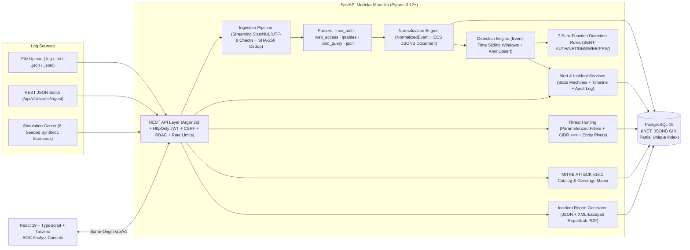

# SENTINEL SOC

**Professional Security Monitoring, Threat Detection & Incident Response Platform**

[](LICENSE)
[](backend/pyproject.toml)
[](backend/app/main.py)
[](docker-compose.yml)
[](frontend/package.json)
[](backend/app/mitre/data/attack_subset.json)

> **Synthetic Demonstration Telemetry Notice:** All attack and baseline scenarios generated by the built-in Simulation Center (`app/simulation/`) and sample log files (`backend/sample_logs/`) are **100% synthetic** (`is_synthetic=true`). They use RFC 5737 documentation IP blocks (`192.0.2.0/24`, `198.51.100.0/24`, `203.0.113.0/24`) and RFC 2606 reserved domains (`.test`, `.example`). The simulator writes normalized records through the ingestion pipeline and never generates real network traffic or scans external systems.

---

## 1. Overview

**SENTINEL SOC** is a self-hosted, modular monolith Security Operations Center (SOC) platform that implements the full security monitoring lifecycle:

1. **Multi-Format Log Ingestion** — Accepts file uploads (`.log`, `.txt`, `.json`, `.jsonl`), JSON event batches via REST API, and deterministic synthetic scenario runs with automatic format detection and SHA-256 event deduplication.
2. **ECS-Inspired Log Normalization** — Parses Linux `auth.log` (`sshd`, `sudo`, `su`, `useradd`), Nginx/Apache Combined access logs, Linux `iptables`/`UFW` kernel firewall logs, BIND 9 DNS query logs, and structured JSON events into a unified schema backed by PostgreSQL `INET` and `JSONB` columns.
3. **Pure-Python Heuristic Detection Engine** — Evaluates 7 configurable sliding-window detection rules with CIDR/domain allowlists, severity escalation on compromise indicators, and database-enforced alert deduplication.
4. **Alert Triage & NIST SP 800-61 Incident Response** — Enforces state-machine transitions (`new` → `investigating` → `resolved` / `false_positive` with mandatory closure rationale notes), groups correlated alerts into incidents across 6 IR phases (`open` → `investigating` → `containment` → `eradication` → `recovery` → `closed`), and records an append-only timeline and audit trail.
5. **MITRE ATT&CK® v16.1 Coverage Matrix** — Clearly distinguishes techniques with **Implemented** active rule coverage from **Documented Only** reference techniques across 13 Enterprise tactics.
6. **Hypothesis-Driven Threat Hunting & Entity Pivoting** — Provides 5 one-click predefined hunts, parameterized CIDR/field filters, and single-click IP and User entity pivots.
7. **Executive Incident Reporting** — Exports structured JSON and ReportLab PDF incident reports with XML-escaped evidence samples, timelines, MITRE mappings, and remediation playbooks.

---

## 2. Architecture



---

## 3. Technology Stack

| Layer | Technologies |
|---|---|
| **Backend** | Python 3.12+, FastAPI, Pydantic v2, pydantic-settings, SQLAlchemy 2.0 (sync), Alembic, psycopg 3, structlog, argon2-cffi, PyJWT, ReportLab, tldextract (offline PSL mode) |
| **Database** | PostgreSQL 16 (`INET` network containment `<<=`, `JSONB` with `GIN` index, partial unique index `uq_alerts_open_dedup_key`, sequences for `ALR-`/`INC-` references) |
| **Frontend** | React 19, TypeScript 5.9, Vite 7, Tailwind CSS 4, Recharts 3, React Router 7, Lucide Icons |
| **Testing & QA** | Pytest, pytest-cov, FastAPI TestClient, Ruff (lint + format), Mypy (strict mode), Vitest, React Testing Library |
| **Infrastructure** | Docker, Docker Compose, unprivileged Nginx reverse proxy, GitHub Actions CI |

---

## 4. Detection Rules (`app/detection/rules/`)

Full specifications and false-positive tuning guidance are documented in [`docs/detection-rules.md`](docs/detection-rules.md).

| Rule ID | Rule Name | Default Threshold & Window | Severity | Primary MITRE Technique |
|---|---|---|---|---|
| `SENT-AUTH-001` | **SSH Brute Force Detection** | `>= 10` failed SSH logins from one IP in `300s` | `high` → `critical` on subsequent login success | `T1110.001` Password Guessing |
| `SENT-AUTH-002` | **Password Spraying Detection** | `>= 5` distinct usernames failed from one IP in `1800s` (`<= 3.0` avg attempts/user) | `high` → `critical` on login success | `T1110.003` Password Spraying |
| `SENT-AUTH-003` | **Multiple Failed Logins (Single Account)** | `>= 5` failures against one username in `900s` | `medium` → `high` if `>= 3` source IPs | `T1110.001` Password Guessing |
| `SENT-NET-001` | **Port Scanning Detection** | `>= 20` distinct ports in `60s` (vertical) or `>= 15` hosts on 1 port (horizontal) | `medium` | `T1046` Network Service Discovery |
| `SENT-DNS-001` | **Suspicious DNS Activity** | Query len `> 75`, label `> 50`, subdomain entropy `> 3.8` (len `>= 20`), suspicious TLD, or `>= 50` subdomains in `600s` | `medium` / `high` | `T1071.004` Application Layer Protocol: DNS |
| `SENT-WEB-001` | **Suspicious HTTP Activity** | Traversal (`../`, double-encoded `%252e%252e%252f`), `.env`/`.git` probe, SQLi, XSS, scanner UA, or `>= 30` HTTP 404s in `300s` | `medium` / `high` / `critical` (on 2xx) | `T1190` Exploit Public-Facing Application |
| `SENT-PRIV-001` | **Unusual Privileged Activity** | Unauthorised `sudo`/`su`, root SSH login, `useradd`, `/etc/shadow`, `/etc/sudoers`, `history -c`, `curl\|bash`, or `>= 3` sudo failures in `3600s` | `high` / `critical` | `T1548.003` Sudo and Sudo Caching |

---

## 5. Synthetic Simulation Scenarios (`app/simulation/scenarios.py`)

| Scenario ID | Category | Description | Expected Alert Triggers |
|---|---|---|---|
| `normal_activity` | `benign` | SSH publickey logins, 1 isolated password typo + success, authorised admin sudo, normal web & DNS traffic | **0 alerts** (Benign regression check) |
| `ssh_brute_force` | `credential_access` | 24 failed SSH attempts from `203.0.113.45` followed by a successful login to `deploy` | `SENT-AUTH-001` (`critical`), `SENT-AUTH-002` |
| `password_spraying` | `credential_access` | 1 failed attempt each across 10 accounts from `198.51.100.77` | `SENT-AUTH-002` |
| `port_scan` | `discovery` | 34 TCP ports probed from `192.0.2.99` against `10.0.1.10` in 20 seconds | `SENT-NET-001` |
| `suspicious_dns` | `command_and_control` | 12 high-entropy TXT subdomain queries from `10.0.2.44` to `*.c2-tunnel.example.test` | `SENT-DNS-001` |
| `suspicious_http` | `initial_access` | `.env`, `.git/config`, SQLi, XSS, and double-encoded `/etc/passwd` traversal from `203.0.113.112` | `SENT-WEB-001` (`critical`) |
| `privileged_activity` | `privilege_escalation` | Unauthorised `intern01` running `/etc/shadow` read, `useradd`, `curl\|bash`, and `history -c` | `SENT-PRIV-001` (`critical`) |
| `multi_stage_attack` | `multi_stage` | Full kill-chain from `203.0.113.200`: port scan → SSH brute force & compromise of `webadmin` → sudo `/etc/shadow` + `history -c` → DNS tunneling exfiltration | `SENT-NET-001`, `SENT-AUTH-001`, `SENT-AUTH-003`, `SENT-PRIV-001`, `SENT-DNS-001` |

---

## 6. Quick Start

### Option A: Docker Compose (Recommended)

1. Copy `.env.example` to `.env` and set strong random values for `SECRET_KEY`, `POSTGRES_PASSWORD`, and `SENTINEL_ADMIN_PASSWORD`:
   ```bash
   cp .env.example .env
   ```
2. Build and start PostgreSQL 16, the FastAPI backend, and the Nginx/React frontend:
   ```bash
   docker compose up --build
   ```
3. Open **`http://localhost:8080`** in your browser.
   - Interactive OpenAPI documentation is served at **`http://localhost:8000/api/docs`**.

### Option B: Local Development (Native PostgreSQL 16 + Python 3.12 + Node 22+)

1. **Backend setup:**
   ```bash
   cd backend
   python -m venv .venv
   # Windows PowerShell:
   .\.venv\Scripts\Activate.ps1
   pip install -e ".[dev]"

   # Run migrations, create demo users, and seed synthetic demo scenarios:
   alembic upgrade head
   $env:SENTINEL_USER_PASSWORD="SentinelAdmin!2026"
   python -m app.cli create-user --username admin --role admin --display-name "Alice Vance (Lead SecOps)" --if-not-exists
   python -m app.cli create-user --username analyst --role analyst --display-name "Marcus Chen (SOC Analyst)" --if-not-exists
   python -m app.cli seed-demo

   # Start the API server on :8000
   uvicorn app.main:create_app --factory --reload --port 8000
   ```
2. **Frontend setup:**
   ```bash
   cd frontend
   npm install
   npm run dev
   ```
   Open **`http://localhost:5173`** (Vite automatically proxies `/api` to `http://127.0.0.1:8000`).

---

## 7. Running Automated Tests & Quality Checks

### Backend (25 Unit, Integration, API & Migration Tests)
```bash
cd backend
ruff check app tests
ruff format --check app tests
mypy app
pytest --cov=app -v
```

### Frontend (TypeScript, Vitest & Production Build)
```bash
cd frontend
npm run typecheck
npm test
npm run build
```

---

## 8. REST API Reference (`/api/v1`)

| Method | Endpoint | Role | Description |
|---|---|---|---|
| `GET` | `/api/v1/health` | Public | Liveness probe |
| `GET` | `/api/v1/health/ready` | Public | Readiness probe (verifies PostgreSQL connectivity) |
| `POST` | `/api/v1/auth/login` | Public (rate-limited) | Authenticate and set `HttpOnly`, `SameSite=Strict` session cookie |
| `POST` | `/api/v1/auth/logout` | Authenticated | Clear session cookie |
| `GET` | `/api/v1/auth/me` | Authenticated | Current authenticated analyst profile |
| `GET` | `/api/v1/dashboard/overview` | Viewer+ | KPIs, hourly timeline, severity distribution, top IPs, recent alerts |
| `GET` | `/api/v1/events` | Viewer+ | Search & filter normalized events (`ip`, `cidr`, `username`, `event_type`, `q`, etc.) |
| `POST` | `/api/v1/events/ingest` | Analyst+ | Ingest structured JSON event batch and run windowed detections |
| `POST` | `/api/v1/events/upload` | Analyst+ | Upload `.log`/`.txt`/`.json`/`.jsonl` file (`auto` or explicit parser) |
| `GET` | `/api/v1/detections/rules` | Viewer+ | List all 7 detection rules, thresholds, windows, and MITRE mappings |
| `PATCH` | `/api/v1/detections/rules/{rule_id}` | Admin | Tune rule `enabled`, `severity`, `threshold`, `time_window_seconds`, `parameters` |
| `POST` | `/api/v1/detections/run` | Analyst+ | Re-evaluate enabled detection rules over a time window |
| `GET` | `/api/v1/alerts` | Viewer+ | Filterable, paginated alert queue |
| `GET` | `/api/v1/alerts/{alert_id}` | Viewer+ | Alert detail, evidence JSON, playbook steps, and investigation notes |
| `PATCH` | `/api/v1/alerts/{alert_id}` | Analyst+ | Transition alert status (note required on close) or assign analyst |
| `GET` | `/api/v1/alerts/{alert_id}/events` | Viewer+ | Correlated evidence events linked to the alert |
| `POST` | `/api/v1/alerts/{alert_id}/notes` | Analyst+ | Append an investigation note to an alert |
| `GET` | `/api/v1/incidents` | Viewer+ | List security incidents |
| `POST` | `/api/v1/incidents` | Analyst+ | Create an incident and group alerts |
| `GET` | `/api/v1/incidents/{incident_id}` | Viewer+ | Incident detail, linked alerts, timeline, and notes |
| `PATCH` | `/api/v1/incidents/{incident_id}` | Analyst+ | Advance NIST SP 800-61 incident status or update findings/resolution |
| `POST` | `/api/v1/incidents/{incident_id}/notes` | Analyst+ | Append an investigation note and timeline entry |
| `GET` | `/api/v1/mitre/techniques` | Viewer+ | List MITRE techniques with computed coverage (`implemented`/`disabled`/`documented`) |
| `GET` | `/api/v1/mitre/coverage` | Viewer+ | Full 13-tactic Enterprise coverage matrix |
| `GET` | `/api/v1/hunting/entities/ip/{ip}` | Viewer+ | IP entity pivot (event breakdown, targeted users/ports, alerts) |
| `GET` | `/api/v1/hunting/entities/user/{user}` | Viewer+ | User entity pivot (source IPs, outcomes, executed commands, alerts) |
| `POST` | `/api/v1/hunting/queries/{id}/run` | Viewer+ | Run a predefined hypothesis-driven hunt query |
| `GET` | `/api/v1/simulations` | Viewer+ | List synthetic scenarios and recent simulation runs |
| `POST` | `/api/v1/simulations/{id}/run` | Analyst+ | Execute a synthetic scenario (`seed` optional) |
| `GET` | `/api/v1/reports/incidents/{id}` | Viewer+ | Export structured JSON incident report |
| `GET` | `/api/v1/reports/incidents/{id}/pdf` | Viewer+ | Download formatted PDF incident report |

---

## 9. Security & Known Limitations

See [`SECURITY.md`](SECURITY.md) and [`docs/threat-model.md`](docs/threat-model.md) for the complete STRIDE threat model, implemented defensive controls, and honest disclosure of architectural limitations.

---

## 10. Attribution & License

- **MITRE ATT&CK®:** MITRE ATT&CK® and ATT&CK® are registered trademarks of The MITRE Corporation. Technique definitions in `backend/app/mitre/data/attack_subset.json` reference Enterprise ATT&CK v16.1 (`https://attack.mitre.org/`).
- **License:** Released under the [MIT License](LICENSE).
